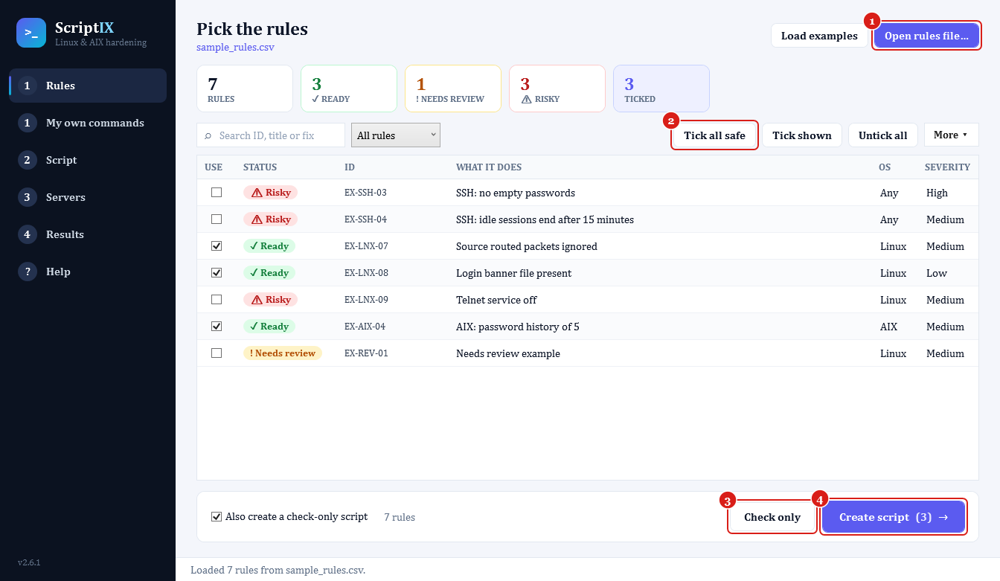
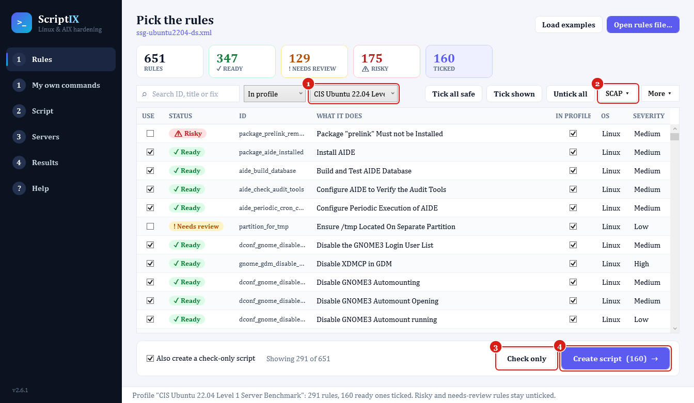
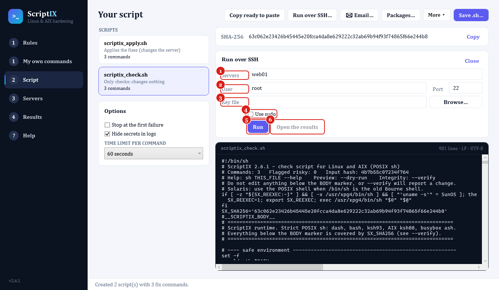
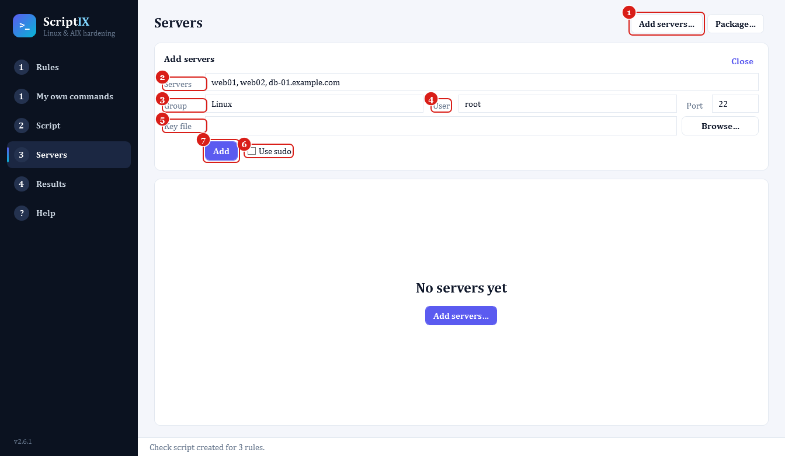
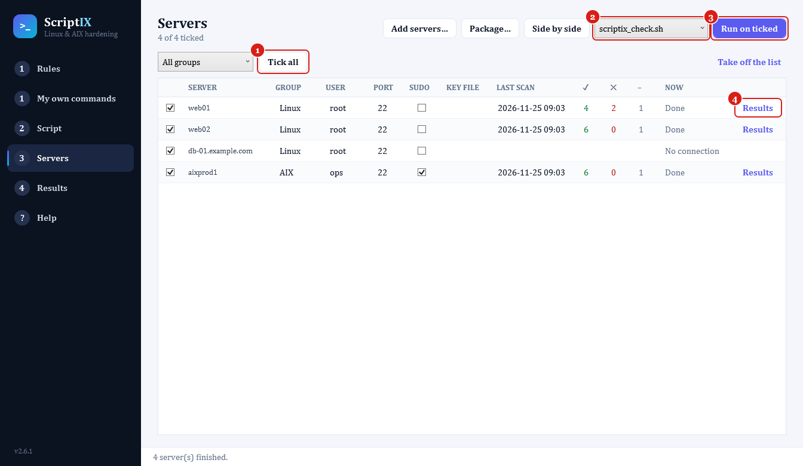
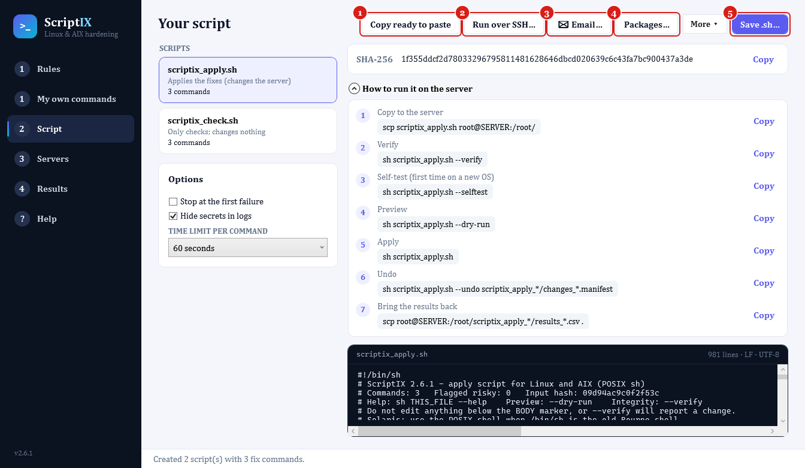
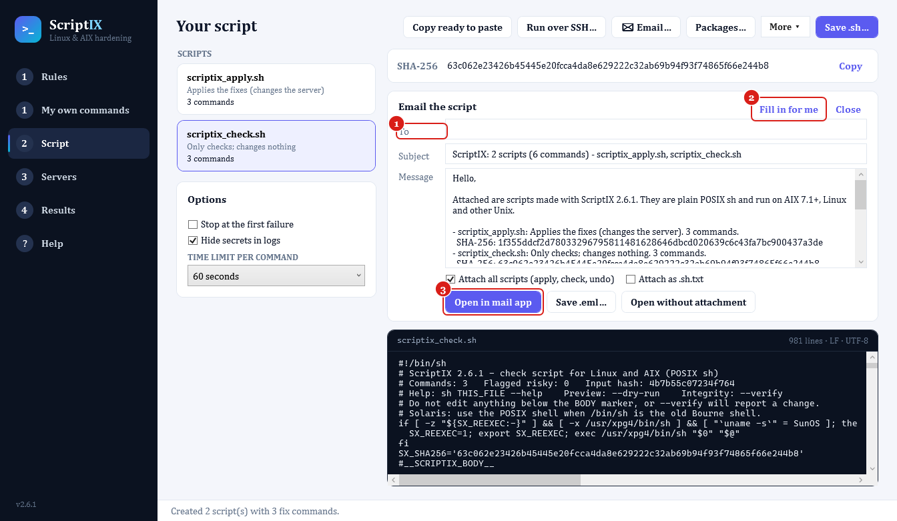
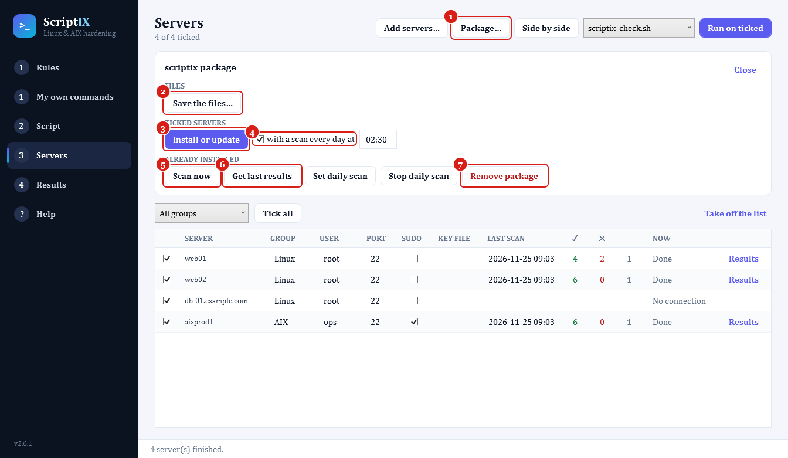
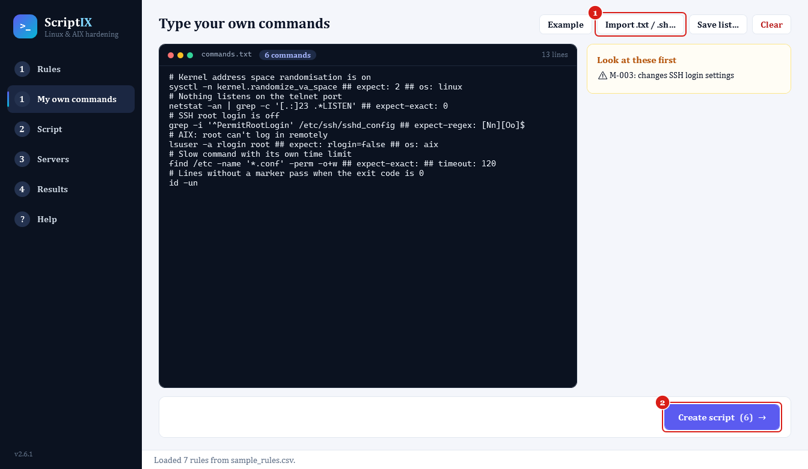
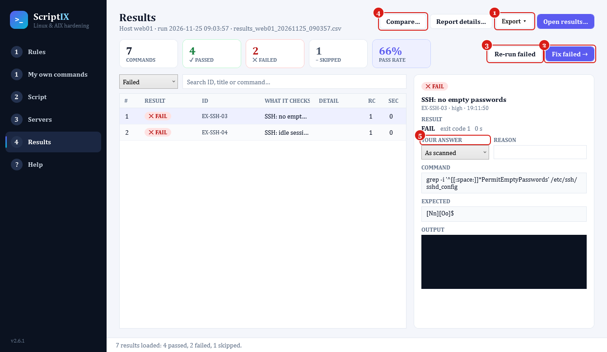

# ScriptIX, step by step

For people who have never used it. You need no Linux knowledge to start. Do the steps in order and read the short notes.

**The three rules**

1. **A check only reads.** It changes no setting on the server. You can run it as often as you like.
2. **A fix changes the server.** Try it on a test server first, and have a backup.
3. **Keep a second window logged in as root** while you change SSH or password settings, so you can't lock yourself out.

## 1. Which way is for you?

All ways do the same checks. Start with the first line that fits.

| You want to | Use | Section |
|---|---|---|
| Try it with no server at all | Practice on your own PC | 4 |
| Scan one server from Windows | **Run over SSH** | 5 |
| Scan many servers from Windows | **Servers** page | 6 |
| Scan a server you already have a black window (SSH) open on | **Copy ready to paste** | 7 |
| Scan a server you can't reach from this PC | Save the file and carry it, or **Email** | 8 |
| Have the scanner stay on the server | Install the **package** | 9 and 10 |
| Scan on the server with a SCAP file, like OpenSCAP | `scriptix eval` | 10 |
| Let one server scan the others | `scriptix ssh` | 11 |
| Scan every day by itself | Daily scan | 12 |
| Run your own list of commands | **My own commands** | 13 |
| Do it without any window, in a script | `scriptix-cli` | 14 |

After the scan: read the results (15), fix (16), prove it is fixed (17), make a report (18).

## 2. The words you will see

| Word | What it means |
|---|---|
| Server | The computer you want to check: Linux, AIX or another Unix. |
| SSH | The way to log in to a server from another computer. ScriptIX uses the one that comes with Windows. |
| root | The administrator of a server. Some checks only work as root. |
| sudo | Lets a normal user do one thing as root. |
| Rule | One thing to check, for example "root can't log in over SSH". |
| CIS | An organization that writes lists of security rules (benchmarks), one for each system. |
| SCAP | A file (`.xml`) with rules a program can check by itself. It gives the most automatic checks. |
| Profile | A choice of rules in a SCAP file or CIS PDF, for example *Level 1 Server*. Start with Level 1. |
| Script | A text file with commands. ScriptIX makes it, the server runs it. |
| Check script | Only reads. Named `scriptix_check.sh`. |
| Apply script | Changes the server. Named `scriptix_apply.sh`. It asks first. |
| Dry run | Shows what would change, and changes nothing. |
| Package | Installs the `scriptix` command on a server. |

## 3. Get ready (once)

### Start the app

1. Right-click the zip file > **Extract All…**. Don't run it from inside the zip.
2. Open the folder `ScriptIX`, then `dist`, and double-click **ScriptIX.exe**.
3. If Windows says *"Windows protected your PC"*: the app is not signed. If you got the zip from a place you trust, press **More info**, then **Run anyway**.
4. If Windows asks for **.NET**: press the link, install the **.NET 8 Desktop Runtime (x64)**, and start ScriptIX again.
5. A short intro opens. Press **Next** through it. You can see it again in **Help > Replay intro**.

The pages are on the left, numbered in the order you use them: **1 Rules**, **2 Script**, **3 Servers**, **4 Results**.

### What to ask your server administrator

- The **name** or IP address of the server, for example `web01`
- A **user name**, and its **password** or **key file**
- Is that user `root`? If not: may it use `sudo`?
- Permission to scan it

### Test that you can log in

1. Press the Windows key, type `powershell`, press Enter.
2. Type this with your own user and server, and press Enter:

```powershell
ssh root@web01
```

3. The first time it asks *"Are you sure you want to continue connecting"*. Compare the fingerprint with the one your administrator has, type `yes`, press Enter.
4. Type the password. **Nothing shows while you type.** That is normal. Press Enter.
5. You see a new line, for example `root@web01:~#`. It works. Type `exit`.

If this works, ScriptIX works too. If not, see section 20.

### Get the rules

Pick one. You can also start with the examples in the app and do this later.

| Rules | Where | Good to know |
|---|---|---|
| **Examples** | In the app: **Try the examples** | 7 small rules to learn with. |
| **SCAP file** | Linux: install `scap-security-guide` (Red Hat, SUSE) or `ssg-debderived` and `ssg-debian` (Debian, Ubuntu). The files are in `/usr/share/xml/scap/ssg/content`, for example `ssg-ubuntu2204-ds.xml`. Or your CIS or DISA download. | Best choice. Most rules are checked automatically. Take the file made for **your** system and version. |
| **CIS PDF** | Your CIS download | The app reads the commands from the PDF. Many rules need a look by you. The usual choice for AIX. |
| **Your own list** | A text file, one command per line | Section 13. |

To bring a SCAP file from a server to your PC, in PowerShell:

```powershell
scp root@web01:/usr/share/xml/scap/ssg/content/ssg-ubuntu2204-ds.xml .
```

## 4. Practice on your own PC (no server needed)

Windows can run a small Linux by itself. It is called WSL. In this section the Ubuntu window is your server.

1. Open PowerShell as administrator (right-click > **Run as administrator**), type this, and restart the PC when it asks. Then make up a user name and password when it asks.

```powershell
wsl --install -d Ubuntu-24.04
```

2. In ScriptIX: page **1 Rules**, press **Try the examples**, then **Check only**.
3. Page **2 Script**: press **Copy ready to paste**.
4. Open **Ubuntu** from the Start menu. Type `cd` and press Enter, then right-click in the window to paste, and press Enter.
5. It says *Ready*. Type:

```sh
sudo sh scriptix_check.sh -y
```

6. The last line says how many passed, failed and were skipped. You made your first scan.
7. To see it in the app, copy the results to your Windows Downloads (put your Windows user name in place of `YOU`):

```sh
sudo sh -c 'cp scriptix_check_*/results_*.csv /mnt/c/Users/YOU/Downloads/'
```

8. Drop that `results_….csv` file on the ScriptIX window. You are on page **4 Results**.

This scans the small Linux, not Windows. ScriptIX does not scan Windows.

## 5. Scan one server from Windows

Nothing is installed on the server.



1. Page **1 Rules**. Press **Open rules file…** and pick your SCAP file or CIS PDF, or press **Try the examples**.
2. If the file has profiles, pick one in the **Profile** box, for example *Level 1 Server*.
3. Press **Check only** (3 in the picture). Page 2 opens with the script `scriptix_check.sh`.



4. Page **2 Script**: press **Run over SSH…**.



5. Fill in:
   - **1 Servers**: the name, for example `web01`. Several: put spaces or commas between them.
   - **2 User**: for example `root`.
   - **3 Key file**: only if you log in with a key. Leave it empty for a password.
   - **4 Use sudo**: tick it if the user is not root.
6. Make sure **scriptix_check.sh** is the selected one on the left, then press **Run** (5). A black window opens.
7. Type the password **in the black window**. ScriptIX never sees it. With sudo it can ask more than once.
8. Wait until it says **Finished**. Press any key to close it.
9. Back in ScriptIX press **Open the results** (6).

A user that is not root and has no sudo can scan too, but rules that need root are SKIPPED.

## 6. Scan many servers from Windows

1. Make the check script as in section 5, steps 1 to 3.
2. Page **3 Servers**: press **Add servers…**.



3. Type the names with spaces or commas between them, a **Group** if you like (for example `AIX`), the **User**, and **Use sudo** if it is not root. Press **Add**. Passwords are never saved.
4. Tick the servers, or press **Tick all** (1). Pick `scriptix_check.sh` in the box (2) and press **Run on ticked** (3).



5. The black window does one server after the other and asks for each password. With key files it does not ask.
6. Each row shows passed ✓, failed ✕, skipped –. Press **Results** (4) to open one.
7. **Side by side** shows all servers next to each other, rule by rule. **Save as CSV…** opens in Excel.

Closed the black window too early? Press **Stop waiting** and run it again.

## 7. Copy and paste into an SSH window

Good with PuTTY, or when you are already logged in to the server.



1. Make the script as in section 5, steps 1 to 3. On page **2 Script**, select it and press **Copy ready to paste** (1).
2. In the SSH window, be root (`sudo -s`) and go to a folder you want, for example `cd /root`.
3. Right-click to paste. Press Enter.
4. It writes the file and checks that nothing got lost on the way. For a check script it says *Ready*. Run it:

```sh
sh scriptix_check.sh -y
```

5. For a fix script, it has already shown you the preview. Nothing is changed yet. Section 16 goes on from there.
6. Bring the results to your PC. In PowerShell on Windows:

```powershell
scp root@web01:/root/scriptix_check_*/results_*.csv .
```

7. Drop the file on the ScriptIX window.

If it says the hash is wrong, the paste was damaged. Use section 8.

## 8. Carry the file, or email it

**Save and copy**

1. Page **2 Script**: press **Save .sh…** (5 in the picture of section 7).
2. In PowerShell, go to the folder of the file and copy it to the server:

```powershell
scp scriptix_check.sh root@web01:/root/
```

3. Log in to the server and run:

```sh
sh scriptix_check.sh --verify
sh scriptix_check.sh --selftest
sh scriptix_check.sh -y
```

`--verify` says the file was not changed on the way. `--selftest` says the server has every tool the script needs (do it the first time on a new kind of system, above all on AIX).

4. Bring `results_*.csv` back and drop it on the ScriptIX window. No network at all? Use a USB stick for both ways.

**Email it to someone**



1. Page **2 Script**: press **✉ Email…**.
2. Type the address (1), or leave it for later. **Fill in for me** (2) writes the text with the steps.
3. Press **Open in mail app** (3). Your own mail program opens with the script attached. Look at it and press Send there. ScriptIX sends nothing itself.
4. If the mail filter removes `.sh` files, tick **Attach as .sh.txt**.

## 9. Install the package on servers

The package puts the `scriptix` command on a server. Then the server can scan itself, every day too, without Windows.



**From Windows**

1. Make the check scripts you want on the server (section 5, steps 1 to 3). Without any, the package brings 36 basic checks.
2. Page **3 Servers**: tick the servers, press **Package…** (1).
3. If you want a daily scan, tick **with a scan every day at** (4) and type the time.
4. Press **Install or update** (3). If a SCAP file is open, ScriptIX asks whether to put it in too: press **Yes** if you want to use `scriptix eval` there. Type the password in the black window.
5. Later, with the servers ticked: **Scan now** (5) scans and brings the results. **Get last results** (6) only brings the last ones. Both bring the results of the **first check script** only. For the others use the commands in section 10.
6. **Remove package** (7) takes it off again. The results stay on the server.

**By hand**

Take the file from the folder `packages` in the zip, or press **Save the files…** (2) to make it with your own scripts inside. Copy it to the server with `scp`, and as root:

| System | Command |
|---|---|
| Debian, Ubuntu | `dpkg -i scriptix_…_all.deb` |
| Red Hat, Rocky, Alma, Oracle, SUSE | `rpm -Uvh scriptix-….noarch.rpm` (the one **without** `aix` in the name) |
| AIX with rpm | `rpm -Uvh scriptix-….aix6.1.noarch.rpm` |
| AIX without rpm | `sh scriptix-…-aix.sh --install` |

Type the real file name in place of the dots. On AIX use one of the two, not both. Installing runs no scan.
The packages are not signed: compare with `SHA256SUMS` before you install. The AIX files were not tested on a real AIX yet, so try a test server first.

## 10. Scan on the server

Log in to the server as root (or `sudo -s`). Type the commands exactly.

**The simple scan (no file needed)**

```sh
scriptix scan
scriptix results
scriptix report basic
```

The first one scans, the second shows what failed, the third writes a web page `scriptix_basic.html`. A package with your own scripts inside has other names in place of `basic`: `scriptix list` shows them.

**With a SCAP file, like OpenSCAP**

1. See which files the server has. The one marked *used when no file is named* is the one for this system:

```sh
scriptix content
```

2. No file? Install one (as in section 3), copy one over, or have it in the package (section 9).
3. See the profiles. The last word of each name, after `profile_`, is what you type in the next step:

```sh
scriptix info
```

4. Scan and make a web page:

```sh
scriptix eval --profile cis_level1_server --report report.html
```

With your own file, put its name at the end: `scriptix eval --profile cis_level1_server --report report.html myfile.xml`

5. Bring the page to your PC, in PowerShell, and double-click it:

```powershell
scp root@web01:/root/report.html .
```

**Keep it, so you don't type it again.** After this, `scriptix scan`, the daily scan and `scriptix ssh` use it too:

```sh
scriptix add /usr/share/xml/scap/ssg/content/ssg-ubuntu2204-ds.xml --profile cis_level1_server --name cis
scriptix scan cis
scriptix results cis
scriptix report cis
```

**Put a script from the app on a server that has the package.** Save it on page 2, copy it over, then:

```sh
scriptix add scriptix_check.sh
scriptix list
scriptix scan check
```

SCAP files need `perl` on the server. Most systems have it, AIX too.

## 11. Let one server scan the others

One server with the package scans servers that have nothing installed. Log in to it as root.

```sh
scriptix ssh root@web02
scriptix ssh admin@web02 web03 --sudo
scriptix ssh -c ssg-ubuntu2204-ds.xml --profile cis_level1_server --out reports root@web02
```

1. The first line runs the check scripts of this server on `web02`.
2. `--sudo` is for a user that is not root.
3. `-c` scans with a SCAP file. `--out reports` writes a report of each server in that folder.

Many servers: write one per line in a file, for example `servers.txt`, then:

```sh
scriptix ssh -f servers.txt
scriptix servers
scriptix results --host web02
```

`ssh` asks for the passwords. They are never saved. With keys (`-i KEY`) it does not ask.

## 12. Scan every day by itself

- **From Windows:** page **3 Servers > Package… > Set daily scan** (the package must be installed). **Stop daily scan** ends it.
- **On the server:**

```sh
scriptix schedule daily 02:30
scriptix schedule weekly sun 03:00
scriptix schedule
scriptix schedule off
```

The time is the server's own time. There is one schedule: the second line replaces the first. The third line shows it, the last one stops it.

What changed since the scan before:

```sh
scriptix diff
```

## 13. Your own commands



1. Page **1 My own commands**. Type one command per line. Press **Example** to see some, or **Import .txt / .sh…** (1).
2. Say what you expect at the end of the line:

| You type | It passes when |
|---|---|
| `id -un` | the command ends without an error |
| `id -un ## expect: root` | the output contains `root` |
| `id -un ## expect-exact: root` | the output is exactly `root` |
| `netstat -an ## expect-not: telnet` | the output does not contain `telnet` |
| `lsuser -a rlogin root ## expect: rlogin=false ## os: aix` | on AIX only. Skipped elsewhere. |

3. A line that starts with `#` is the name of the next command.
4. Press **Create script →** (2). Go on with any way from sections 5 to 8.

ScriptIX can't know what your own commands do, so it treats them as a script that can change the server: it asks before it runs. The script has no undo for your own commands, except for the helpers (Help > Helpers).

## 14. Without the window (command line)

Open PowerShell in the folder `dist`:

```powershell
.\scriptix-cli.exe profiles rules.xml
```

```powershell
.\scriptix-cli.exe generate rules.xml --profile cis_level1_server --check-only --out C:\scans
```

```powershell
.\scriptix-cli.exe report C:\scans\results.csv --html C:\scans\report.html --docx C:\scans\report.docx
```

```powershell
.\scriptix-cli.exe package C:\scans\scriptix_check.sh --content rules.xml --out C:\scans\packages
```

They show the profiles, make a check script, make reports from a results file, and make packages. Run `scriptix-cli.exe` alone to see everything.

## 15. Read the results



Click a row to see the command, what was expected, and what came out.

| Result | What it means | What to do |
|---|---|---|
| **PASS** | It is as the rule wants it. | Nothing. |
| **FAIL** | It is not. | Read the row. Fix it (section 16), or decide to accept it. |
| **SKIPPED: OTHER-OS** | The rule is for another system. | Nothing. |
| **SKIPPED: NOT-APPLICABLE** | The rule does not fit this server. | Nothing. If **every** rule says this, it is the wrong file for this system. |
| **SKIPPED: NOT-CHECKED** | It can't be tested here, or needs root. | Scan as root or with sudo. Else check it yourself. Never counted as a pass. |
| **SKIPPED: MANUAL** | A person must look. | Check it, then set **YOUR ANSWER** and a **REASON** in the row's details. |
| **FAIL: TIMEOUT** | The command took too long. | Page 2 > **TIME LIMIT PER COMMAND**, and scan again. |

**WAIVED** as your answer means: it fails, and you accept that. Write the reason. It is in the report.

## 16. Fix what failed

**First:** a test server, a backup, a second root window. Every time.

**From Windows**

1. On page **1 Rules**, have the same rules open as for the scan. On page **4 Results**, press **Fix failed →** (2 in the picture above).
2. Page 2 opens with `scriptix_fix_failed.sh`. Read it. Risky rules can lock you out. To leave some out, add `--skip` and their IDs in step 4: `sh scriptix_fix_failed.sh --skip EX-SSH-03,EX-SSH-04`.
3. Press **Copy ready to paste** and paste it in the SSH window as root. It shows a **preview** and changes nothing.
4. Happy with it? Type this. It explains, and asks before it starts. Type `y`:

```sh
sh scriptix_fix_failed.sh
```

5. Log in again **in a new window** before you close the old one.

You can also run it with **Run over SSH…** or **Run on ticked**. The black window asks before anything is changed, but there is no preview there.

To fix chosen rules without a scan: page 1, tick rules (**Tick all safe** is a good start), press **Create script →**, and go on from step 2 with `scriptix_apply.sh`.

**Put it back.** In the same folder on the server, with the name of the script you ran:

```sh
sh scriptix_fix_failed.sh --undo scriptix_fix_*/changes_*.manifest
```

If you ran it more than once, type the name of the newest folder in place of `scriptix_fix_*`. This puts back what the ScriptIX helpers changed. **Fixes that come from a SCAP file have no undo.** That is why you need the backup.

**On the server**

```sh
scriptix fix --profile cis_level1_server --results cis --type script --out fix.sh
scriptix add fix.sh
scriptix preview fix
scriptix apply fix
```

This makes a script of only what failed in the scan `cis` (section 10), shows what is in it, and then runs it (it asks first).
All in one go, with a second scan at the end:

```sh
scriptix eval --profile cis_level1_server --remediate
```

A script that you made in the app and added with `scriptix add` can be put back with `scriptix undo`.

## 17. Prove that it is fixed

A report shows the moment of the scan. It does not change by itself after a fix. So:

1. Scan again, the same way as the first time.
2. Open the **new** results on page **4 Results**.
3. Press **Compare…** and pick the **old** results file. Now each row also has **BEFORE**, and the report says what changed.

Where the old file is: press the Windows key + R and type `%LOCALAPPDATA%\ScriptIX\ssh`. There is one folder for each run, named by date and time.

On the server, `scriptix diff cis` shows the same.

## 18. Make the report

1. Page **4 Results**: press **Report details…**. Give it a title, your names, your organization, a logo, pictures and notes.
2. Press **Export ▾** (1) and pick one:

| Format | For |
|---|---|
| PDF, Word | Managers and auditors. PDF needs Edge or Chrome on this PC. |
| Excel, CSV | Filter and sort. |
| HTML | Opens in any browser. |
| Text, Markdown, JSON | Other programs. |
| XCCDF, ARF | Other SCAP tools. |
| **All formats…** | Everything in one folder. |

On the server: `scriptix report NAME` makes the HTML page. `--results F.xml` and `--results-arf F.xml` make XCCDF and ARF, `--csv F` the rows. PDF, Word and Excel are only in the app: bring the CSV or XML to Windows and open it there.

## 19. More you can do with a SCAP file

In the app, page **1 Rules**, menu **SCAP ▾** (2 in the second picture of section 5):

| Menu | What for |
|---|---|
| **Info** | What is in the file. |
| **Check this content** | Find mistakes in the file. |
| **Values…** | Change numbers, for example the password length. |
| **Load tailoring… / Save tailoring…** | Your own choice of rules: tick **IN PROFILE** in the list, save it, use it again. |
| **Security guide (.html)…** | All rules as a document to read. |
| **Export fixes** | For Ansible, Puppet and others. |
| **Scan with the server's oscap** | If your company must use OpenSCAP itself. |
| **CVSS score…** | Work out a CVSS score. |

On the server:

```sh
scriptix guide --profile cis_level1_server --out guide.html
scriptix tailor --profile cis_level1_server --unselect sshd_set_idle_timeout --out my.xml
scriptix eval --tailoring-file my.xml
scriptix fix --profile cis_level1_server --type ansible --out fix.yml
scriptix validate myfile.xml
```

## 20. When something goes wrong

| You see | Do this |
|---|---|
| *Windows OpenSSH is not installed* | Windows Settings, search **Optional features**, add **OpenSSH Client**. |
| *Connection refused* or *timed out* | Wrong name or port, the server is off, or a firewall. Try the test in section 3. |
| *Permission denied* | Wrong user or password, or root may not log in over SSH. Use another user and tick **Use sudo**. |
| *REMOTE HOST IDENTIFICATION HAS CHANGED* | Stop. Ask your administrator whether the server was replaced. If yes: `ssh-keygen -R web01`, then try again. |
| The password does not show | Normal. Type it and press Enter. |
| `scp` says *Permission denied* for the results | They belong to root. On the server: `cp FILE /tmp` and `chmod 644 /tmp/FILE`, get it from `/tmp`, then delete it there. |
| *No connection* in the list | As above. Test with `ssh` first. |
| *Package not installed* | Install it first: **Package… > Install or update**. |
| *No results yet* | Wait until the black window says Finished. |
| *run this as root* | Type `sudo -s` first. |
| *SCAP files need perl* | Red Hat: `dnf install perl-interpreter`. Debian, Ubuntu: `apt install perl-base`. |
| *profile not found* | `scriptix info` shows the right names. |
| *No rule could be checked* | The SCAP file is for another system or version. |
| *Another run* is going on | One at a time on each server. Wait for the other one. |
| Most rules are NOT-CHECKED | You scanned without root. |
| *--verify* fails | The file was damaged on the way. Copy it again with `scp`, not by copy and paste. |
| *OVAL checks. Open the SCAP content…* | Open the SCAP file on page 1 first, then press **Fix failed** again. |
| *Saved … No PDF* | PDF needs Edge or Chrome. Or save Word and print it as PDF. |
| The app did something strange | **Help > Open log folder**. |

## 21. Do and don't

**Do**

- Check first, fix later.
- Start with Level 1 and a test server.
- Keep the results files. They prove what you did.
- Read every risky rule before you tick it.

**Don't**

- Don't scan servers without permission.
- Don't fix all servers at once. One, then a few, then the rest.
- Don't change a script by hand: `--verify` will fail. Change the rule in the app and make it again.
- Don't call a server safe because it passed. These are known rules, not everything.

## 22. One page to print

| I want to | In the app | On the server |
|---|---|---|
| Open rules | **1 Rules > Open rules file…** | `scriptix content`, `scriptix info` |
| Scan | **Check only**, then **Run over SSH…** or **Run on ticked** | `scriptix eval --profile P` or `scriptix scan` |
| See what failed | **4 Results** | `scriptix results` |
| Preview a fix | **Copy ready to paste** | `scriptix preview NAME` |
| Fix | **Fix failed →** | `scriptix apply NAME` |
| Undo | `sh SCRIPT --undo MANIFEST` | `scriptix undo` |
| Compare | **Compare…** | `scriptix diff` |
| Report | **Export ▾** | `scriptix report NAME` |
| Every day | **Package… > Set daily scan** | `scriptix schedule daily 02:30` |
| Other servers | **3 Servers** | `scriptix ssh root@OTHER` |
| Help | **F1** | `scriptix help` |
